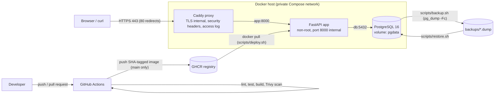

# Architecture

## Components
| Component | Image / source | Exposure | Persistent data |
|---|---|---|---|
| proxy | `caddy:2` | host ports 80, 443 | `caddy_data` volume (local CA and certificates) |
| app | `ghcr.io/wiesslogia/cinema-api:<sha>` | internal 8000 (dev override: `127.0.0.1:8000`) | none |
| db | `postgres:16-alpine` | internal 5432 (dev override: `127.0.0.1:5432`) | `pgdata` volume |

## Request path
1. The client resolves `cinema.localhost` and connects to host port 443; port 80 gets a 308 redirect to HTTPS.
2. Caddy terminates TLS (certificate from its local CA), adds security headers, writes a JSON access log, and forwards to `app:8000` over the private network.
3. The app takes a row lock on the seat, so holds and bookings for one seat are serialized, then reads or writes PostgreSQL.
4. The database enforces the rules: `UNIQUE` on holds per seat, and a partial unique index allowing one `CONFIRMED` booking per seat.

## Release path
Pull request: lint, test, build, scan (nothing published). Push to `main`: the same, then the image is pushed as `ghcr.io/wiesslogia/cinema-api:<7-char sha>` and its digest is recorded in the job summary. The host deploys a tag with `scripts/deploy.sh <sha>`; rolling back is the same command with an older tag.

## Failure behaviour
| Failure | Detected by | Recovery |
|---|---|---|
| Database down | `/ready` returns 503 (`scripts/healthcheck.sh` exits 1); `/health` stays 200 | Start `db`; the app's connection pool reconnects without a restart |
| App crash | Proxy returns 502; restart count rises | `restart: unless-stopped` restarts it; a manual `stop` is not restarted |
| Bad release | Errors after deploy, or `/ready` not 200 | `scripts/deploy.sh <previous-sha>` |
| Data loss | Missing bookings | `scripts/restore.sh` from the latest verified backup |
